# BF16 and NVFP4 Training DAGs

This is the graphical companion to [`NVFP4_PLAN.md`](NVFP4_PLAN.md). The ASCII
charts remain canonical for exact kernel inputs and outputs; these Mermaid
charts expose the same flows as tensor-to-operation DAGs. BF16 and NVFP4 are
placed in parallel lanes, with corresponding phases in the same order.

Each blue rounded node is a tensor. Its label gives dtype, logical shape, and
storage or lifetime where relevant. Each orange rectangular node is an
operation. Green tensor nodes cross the autograd boundary, red tensor nodes are
returned outputs, and gray operation nodes are synchronization boundaries.
An NVFP4 tensor node represents its complete `qdata + scale` bundle.

The symbols, physical NVFP4 layouts, and `[P]`/`[S]`/`[SYM]` storage notation
are defined in [`NVFP4_PLAN.md`](NVFP4_PLAN.md#notation-and-storage).
The diagrams use the default score-and-reduce postprocess, which has no
auxiliary context tensor; a configured postprocess may add its own explicitly
documented saved tensors.

## Staged execution

### Forward: BF16 versus staged NVFP4

```mermaid
flowchart LR
  subgraph SF_B["BF16 FORWARD"]
    direction TB

    sf_b_x(["x_bf16<br/>BF16 [T,D]"])
    sf_b_w13(["w13_bf16<br/>BF16 [E,2F,D]"])
    sf_b_w2(["w2_bf16<br/>BF16 [E,D,F]"])
    sf_b_ids(["topk_ids<br/>INT32/INT64 [T,K]"])
    sf_b_scores(["topk_scores<br/>S [T,K]"])
    sf_b_slot(["slot_id<br/>INT64 [1]"])

    subgraph SF_B_DISPATCH["TOKEN DISPATCH · owners publish rows; experts gather them"]
      direction TB
      subgraph SF_B_PUBLISH["KERNEL GROUP: copy_routing_and_dispatch"]
        direction TB
        sf_b_copy_x["copy dispatch rows"]
        sf_b_copy_routing["copy routing"]
        sf_b_dispatch_x(["dispatch_x_bf16<br/>BF16 [T,D] · [SYM]"])
        sf_b_routing_ids(["routing_ids<br/>INT16 [T,K]"])
        sf_b_routing_count(["routing_token_count<br/>INT32 [1]"])
        sf_b_x --> sf_b_copy_x --> sf_b_dispatch_x
        sf_b_ids --> sf_b_copy_routing
        sf_b_copy_routing --> sf_b_routing_ids
        sf_b_copy_routing --> sf_b_routing_count
      end

      sf_b_dispatch_barrier["expert-parallel dispatch barrier"]
      sf_b_dispatch_x --> sf_b_dispatch_barrier
      sf_b_routing_ids --> sf_b_dispatch_barrier
      sf_b_routing_count --> sf_b_dispatch_barrier

      subgraph SF_B_ROUTING["KERNEL GROUP: dist_dispatch_routing"]
        direction TB
        sf_b_route["construct expert counts and pointer tables"]
        sf_b_expert_counts(["expert_counts<br/>INT32 [E]"])
        sf_b_recv_rank(["recv_by_rank<br/>INT32 [P]"])
        sf_b_recv_count(["recv_count<br/>INT32 [1]"])
        sf_b_fwd_ptrs(["fwd_gather_ptrs<br/>INT64 [M]"])
        sf_b_bwd_ptrs(["bwd_gather_ptrs<br/>INT64 [M]"])
        sf_b_scatter_ptrs(["scatter_ptrs<br/>INT64 [M]"])
        sf_b_dispatch_barrier --> sf_b_route
        sf_b_ids --> sf_b_route
        sf_b_route --> sf_b_expert_counts
        sf_b_route --> sf_b_recv_rank
        sf_b_route --> sf_b_recv_count
        sf_b_route --> sf_b_fwd_ptrs
        sf_b_route --> sf_b_bwd_ptrs
        sf_b_route --> sf_b_scatter_ptrs
      end

      subgraph SF_B_PLAN["KERNEL: get_forward_plan"]
        direction TB
        sf_b_plan["select full-save or recompute and allocate offsets"]
        sf_b_need(["need_recompute<br/>BOOL [1]"])
        sf_b_state(["forward_state<br/>INT64 [6] · 5 offsets + slot"])
        sf_b_snapshot(["recv_snapshot<br/>INT32 [P]"])
        sf_b_recv_count --> sf_b_plan
        sf_b_recv_rank --> sf_b_plan
        sf_b_slot --> sf_b_plan
        sf_b_plan --> sf_b_need
        sf_b_plan --> sf_b_state
        sf_b_plan --> sf_b_snapshot
      end

      subgraph SF_B_SAVE_X["KERNEL: copy_dispatch_to_activation"]
        direction TB
        sf_b_save_x["conditional copy for RECOMPUTE"]
        sf_b_x_saved(["x_saved_bf16<br/>BF16 [T,D] · [P] RECOMPUTE"])
        sf_b_dispatch_x --> sf_b_save_x
        sf_b_need --> sf_b_save_x
        sf_b_save_x --> sf_b_x_saved
      end

      subgraph SF_B_FC13["KERNEL: BF16 distributed W13 FPROP dispatch"]
        direction TB
        sf_b_fc13["pointer-gather x + grouped BF16 GEMM<br/>FP32 accumulation"]
        sf_b_xg(["x_gathered_bf16<br/>BF16 [M,D] · [P] FULL-SAVE / [S]"])
        sf_b_h1(["h1_bf16<br/>BF16 [M,2F] · [P] FULL-SAVE / [S]"])
        sf_b_dispatch_barrier --> sf_b_fc13
        sf_b_dispatch_x --> sf_b_fc13
        sf_b_fwd_ptrs --> sf_b_fc13
        sf_b_expert_counts --> sf_b_fc13
        sf_b_w13 --> sf_b_fc13
        sf_b_fc13 --> sf_b_xg
        sf_b_fc13 --> sf_b_h1
      end
    end

    subgraph SF_B_COMBINE["TOKEN COMBINE · experts scatter route outputs to owners"]
      direction TB
      subgraph SF_B_SWIGLU["KERNEL: SwiGLU forward · standalone or W13 epilogue"]
        direction TB
        sf_b_swiglu["SwiGLU"]
        sf_b_h2(["h2_bf16<br/>BF16 [M,F] · [S]"])
        sf_b_h1 --> sf_b_swiglu --> sf_b_h2
      end

      subgraph SF_B_FC2["KERNEL: BF16 W2 FPROP + peer combine"]
        direction TB
        sf_b_fc2["grouped BF16 GEMM + peer scatter<br/>FP32 accumulation"]
        sf_b_h3_route(["h3_route_bf16<br/>BF16 [T*K,D] · peer [SYM] combine HBM"])
        sf_b_h2 --> sf_b_fc2
        sf_b_w2 --> sf_b_fc2
        sf_b_expert_counts --> sf_b_fc2
        sf_b_scatter_ptrs --> sf_b_fc2
        sf_b_fc2 --> sf_b_h3_route
      end

      sf_b_combine_barrier["combine-buffer barrier"]
      sf_b_h3_route --> sf_b_combine_barrier

      subgraph SF_B_POST["KERNEL GROUP: default expert postprocess forward"]
        direction TB
        sf_b_post["score route outputs + reduce K<br/>FP32 accumulation"]
        sf_b_y(["y_bf16<br/>BF16 [T,D] · [OUT]"])
        sf_b_h3_saved(["h3_saved_bf16<br/>BF16 [T*K,D] · [P] FULL-SAVE"])
        sf_b_combine_barrier --> sf_b_post
        sf_b_h3_route --> sf_b_post
        sf_b_scores --> sf_b_post
        sf_b_need --> sf_b_post
        sf_b_post --> sf_b_y
        sf_b_post --> sf_b_h3_saved
      end
    end

    subgraph SF_B_SAVE["AUTOGRAD RETENTION"]
      direction TB
      sf_b_save_full["retain FULL-SAVE tensors"]
      sf_b_save_recompute["retain RECOMPUTE tensor"]
      sf_b_save_common["retain common routing, weights, planner, slot,<br/>and postprocess state"]
      sf_b_xg --> sf_b_save_full
      sf_b_h1 --> sf_b_save_full
      sf_b_h3_saved --> sf_b_save_full
      sf_b_x_saved --> sf_b_save_recompute
      sf_b_w13 --> sf_b_save_common
      sf_b_w2 --> sf_b_save_common
      sf_b_ids --> sf_b_save_common
      sf_b_scores --> sf_b_save_common
      sf_b_expert_counts --> sf_b_save_common
      sf_b_fwd_ptrs --> sf_b_save_common
      sf_b_bwd_ptrs --> sf_b_save_common
      sf_b_scatter_ptrs --> sf_b_save_common
      sf_b_recv_count --> sf_b_save_common
      sf_b_need --> sf_b_save_common
      sf_b_state --> sf_b_save_common
      sf_b_snapshot --> sf_b_save_common
    end
  end

  subgraph SF_N["NVFP4 STAGED FORWARD"]
    direction TB

    sf_n_x(["x_bf16<br/>BF16 [T,D]"])
    sf_n_w13(["w13_bf16<br/>BF16 [E,2F,D]"])
    sf_n_w2(["w2_bf16<br/>BF16 [E,D,F]"])
    sf_n_ids(["topk_ids<br/>INT32/INT64 [T,K]"])
    sf_n_scores(["topk_scores<br/>S [T,K]"])
    sf_n_slot(["slot_id<br/>INT64 [1]"])

    subgraph SF_N_WEIGHTS["KERNEL GROUP: prepare dynamic NVFP4 weights"]
      direction TB
      sf_n_q_w13["q(w13_bf16)"]
      sf_n_q_w2["q(w2_bf16)"]
      sf_n_w13_q(["w13_nvfp4<br/>NVFP4 bundle [E,2F,D] · transient"])
      sf_n_w2_q(["w2_nvfp4<br/>NVFP4 bundle [E,D,F] · transient"])
      sf_n_w13 --> sf_n_q_w13 --> sf_n_w13_q
      sf_n_w2 --> sf_n_q_w2 --> sf_n_w2_q
    end

    subgraph SF_N_DISPATCH["TOKEN DISPATCH · owners publish packed rows; experts gather them"]
      direction TB
      subgraph SF_N_PUBLISH["KERNEL GROUP: copy routing + _stage_blockscaled_dispatch"]
        direction TB
        sf_n_q_x["q(x_bf16) + publish complete bundle"]
        sf_n_copy_routing["copy routing"]
        sf_n_x_q(["x_nvfp4<br/>NVFP4 bundle [T,D] · [SYM]"])
        sf_n_routing_ids(["routing_ids<br/>INT16 [T,K]"])
        sf_n_routing_count(["routing_token_count<br/>INT32 [1]"])
        sf_n_x --> sf_n_q_x --> sf_n_x_q
        sf_n_ids --> sf_n_copy_routing
        sf_n_copy_routing --> sf_n_routing_ids
        sf_n_copy_routing --> sf_n_routing_count
      end

      sf_n_dispatch_barrier["expert-parallel dispatch barrier"]
      sf_n_x_q --> sf_n_dispatch_barrier
      sf_n_routing_ids --> sf_n_dispatch_barrier
      sf_n_routing_count --> sf_n_dispatch_barrier

      subgraph SF_N_ROUTING["KERNEL GROUP: dist_dispatch_routing"]
        direction TB
        sf_n_route["construct expert counts and pointer tables"]
        sf_n_expert_counts(["expert_counts<br/>INT32 [E]"])
        sf_n_recv_rank(["recv_by_rank<br/>INT32 [P]"])
        sf_n_recv_count(["recv_count<br/>INT32 [1]"])
        sf_n_fwd_ptrs(["fwd_gather_ptrs<br/>INT64 [M]"])
        sf_n_bwd_ptrs(["bwd_gather_ptrs<br/>INT64 [M]"])
        sf_n_scatter_ptrs(["scatter_ptrs<br/>INT64 [M]"])
        sf_n_dispatch_barrier --> sf_n_route
        sf_n_ids --> sf_n_route
        sf_n_route --> sf_n_expert_counts
        sf_n_route --> sf_n_recv_rank
        sf_n_route --> sf_n_recv_count
        sf_n_route --> sf_n_fwd_ptrs
        sf_n_route --> sf_n_bwd_ptrs
        sf_n_route --> sf_n_scatter_ptrs
      end

      sf_n_gather_view["pointer-select expert rows"]
      sf_n_x_q --> sf_n_gather_view
      sf_n_fwd_ptrs --> sf_n_gather_view
      sf_n_xg_q(["x_gathered_nvfp4<br/>NVFP4 bundle [M,D] · logical view"])
      sf_n_gather_view --> sf_n_xg_q

      subgraph SF_N_PLAN["KERNEL: get_forward_plan"]
        direction TB
        sf_n_plan["select full-save or recompute and allocate offsets"]
        sf_n_need(["need_recompute<br/>BOOL [1]"])
        sf_n_condition(["recompute_condition<br/>INT32 [1] = INT32(need_recompute)"])
        sf_n_offsets(["forward_offsets<br/>INT64 [9]"])
        sf_n_activation_offsets(["activation_offsets<br/>INT64 [18]"])
        sf_n_snapshot(["recv_snapshot<br/>INT32 [P]"])
        sf_n_recv_count --> sf_n_plan
        sf_n_recv_rank --> sf_n_plan
        sf_n_slot --> sf_n_plan
        sf_n_plan --> sf_n_need
        sf_n_plan --> sf_n_condition
        sf_n_plan --> sf_n_offsets
        sf_n_plan --> sf_n_activation_offsets
        sf_n_plan --> sf_n_snapshot
      end

      subgraph SF_N_SAVE_X["PREDICATE-SELECTED SAVE KERNELS"]
        direction TB
        sf_n_copy_x["copy(x_bf16) for RECOMPUTE"]
        sf_n_dq_x["dq(x_gathered_nvfp4) for FULL-SAVE"]
        sf_n_x_saved(["x_saved_bf16<br/>BF16 [T,D] · [P] RECOMPUTE"])
        sf_n_x_q_dq(["x_q_dq_bf16<br/>BF16 [M,D] · [P] FULL-SAVE"])
        sf_n_x --> sf_n_copy_x
        sf_n_condition --> sf_n_copy_x
        sf_n_copy_x --> sf_n_x_saved
        sf_n_xg_q --> sf_n_dq_x
        sf_n_condition --> sf_n_dq_x
        sf_n_dq_x --> sf_n_x_q_dq
      end

      subgraph SF_N_FC13["KERNEL: staged NVFP4 W13 FPROP dispatch"]
        direction TB
        sf_n_fc13["NVFP4 grouped GEMM<br/>FP32 accumulation"]
        sf_n_h1(["h1_bf16<br/>BF16 [M,2F] · [P] FULL-SAVE / [S]"])
        sf_n_dispatch_barrier --> sf_n_fc13
        sf_n_xg_q --> sf_n_fc13
        sf_n_w13_q --> sf_n_fc13
        sf_n_expert_counts --> sf_n_fc13
        sf_n_fwd_ptrs --> sf_n_fc13
        sf_n_activation_offsets --> sf_n_fc13
        sf_n_fc13 --> sf_n_h1
      end
    end

    subgraph SF_N_COMBINE["TOKEN COMBINE · fused activation/FC2 scatters routes to owners"]
      direction TB
      subgraph SF_N_FC2["ONE KERNEL: fused q(SwiGLU) + NVFP4 W2 FPROP + peer combine"]
        direction TB
        sf_n_q_swiglu["q(SwiGLU(h1_bf16))"]
        sf_n_h2_q(["h2_nvfp4<br/>NVFP4 bundle [M,F] · transient [S]"])
        sf_n_fc2["NVFP4 grouped GEMM + peer scatter<br/>FP32 accumulation"]
        sf_n_h3_route(["h3_route_bf16<br/>BF16 [T*K,D] · peer [SYM] combine HBM"])
        sf_n_h1 --> sf_n_q_swiglu --> sf_n_h2_q
        sf_n_h2_q --> sf_n_fc2
        sf_n_w2_q --> sf_n_fc2
        sf_n_expert_counts --> sf_n_fc2
        sf_n_scatter_ptrs --> sf_n_fc2
        sf_n_activation_offsets --> sf_n_fc2
        sf_n_fc2 --> sf_n_h3_route
      end

      sf_n_combine_barrier["combine-buffer barrier"]
      sf_n_h3_route --> sf_n_combine_barrier

      subgraph SF_N_POST["KERNEL GROUP: default expert postprocess forward"]
        direction TB
        sf_n_post["score route outputs + reduce K<br/>FP32 accumulation"]
        sf_n_y(["y_bf16<br/>BF16 [T,D] · [OUT]"])
        sf_n_h3_saved(["h3_saved_bf16<br/>BF16 [T*K,D] · [P] FULL-SAVE"])
        sf_n_combine_barrier --> sf_n_post
        sf_n_h3_route --> sf_n_post
        sf_n_scores --> sf_n_post
        sf_n_need --> sf_n_post
        sf_n_post --> sf_n_y
        sf_n_post --> sf_n_h3_saved
      end
    end

    subgraph SF_N_SAVE["AUTOGRAD RETENTION"]
      direction TB
      sf_n_save_full["retain FULL-SAVE tensors"]
      sf_n_save_recompute["retain RECOMPUTE tensor"]
      sf_n_save_common["retain native weights, routing, planner, slot,<br/>and postprocess state"]
      sf_n_x_q_dq --> sf_n_save_full
      sf_n_h1 --> sf_n_save_full
      sf_n_h3_saved --> sf_n_save_full
      sf_n_x_saved --> sf_n_save_recompute
      sf_n_w13 --> sf_n_save_common
      sf_n_w2 --> sf_n_save_common
      sf_n_ids --> sf_n_save_common
      sf_n_scores --> sf_n_save_common
      sf_n_expert_counts --> sf_n_save_common
      sf_n_fwd_ptrs --> sf_n_save_common
      sf_n_bwd_ptrs --> sf_n_save_common
      sf_n_scatter_ptrs --> sf_n_save_common
      sf_n_recv_count --> sf_n_save_common
      sf_n_need --> sf_n_save_common
      sf_n_condition --> sf_n_save_common
      sf_n_offsets --> sf_n_save_common
      sf_n_activation_offsets --> sf_n_save_common
      sf_n_snapshot --> sf_n_save_common
      sf_n_slot --> sf_n_save_common
    end
  end

  classDef tensor fill:#eaf2ff,stroke:#2563eb,color:#111827,stroke-width:1.5px;
  classDef op fill:#fff3d6,stroke:#d97706,color:#111827,stroke-width:1.5px;
  classDef saved fill:#e8f7e8,stroke:#15803d,color:#111827,stroke-width:2px;
  classDef output fill:#fee2e2,stroke:#dc2626,color:#111827,stroke-width:2px;
  classDef sync fill:#f3f4f6,stroke:#4b5563,color:#111827,stroke-width:1.5px;
  class sf_b_x,sf_b_w13,sf_b_w2,sf_b_ids,sf_b_scores,sf_b_slot,sf_b_dispatch_x,sf_b_routing_ids,sf_b_routing_count,sf_b_expert_counts,sf_b_recv_rank,sf_b_recv_count,sf_b_fwd_ptrs,sf_b_bwd_ptrs,sf_b_scatter_ptrs,sf_b_need,sf_b_state,sf_b_snapshot,sf_b_xg,sf_b_h1,sf_b_h2,sf_b_h3_route,sf_n_x,sf_n_w13,sf_n_w2,sf_n_ids,sf_n_scores,sf_n_slot,sf_n_w13_q,sf_n_w2_q,sf_n_x_q,sf_n_routing_ids,sf_n_routing_count,sf_n_expert_counts,sf_n_recv_rank,sf_n_recv_count,sf_n_fwd_ptrs,sf_n_bwd_ptrs,sf_n_scatter_ptrs,sf_n_xg_q,sf_n_need,sf_n_condition,sf_n_offsets,sf_n_activation_offsets,sf_n_snapshot,sf_n_h2_q,sf_n_h3_route tensor;
  class sf_b_w13,sf_b_w2,sf_b_ids,sf_b_scores,sf_b_expert_counts,sf_b_recv_count,sf_b_fwd_ptrs,sf_b_bwd_ptrs,sf_b_scatter_ptrs,sf_b_x_saved,sf_b_xg,sf_b_h1,sf_b_h3_saved,sf_b_need,sf_b_state,sf_b_snapshot,sf_n_w13,sf_n_w2,sf_n_ids,sf_n_scores,sf_n_expert_counts,sf_n_recv_count,sf_n_fwd_ptrs,sf_n_bwd_ptrs,sf_n_scatter_ptrs,sf_n_x_saved,sf_n_x_q_dq,sf_n_h1,sf_n_h3_saved,sf_n_need,sf_n_condition,sf_n_offsets,sf_n_activation_offsets,sf_n_snapshot,sf_n_slot saved;
  class sf_b_y,sf_n_y output;
  class sf_b_copy_x,sf_b_copy_routing,sf_b_route,sf_b_plan,sf_b_save_x,sf_b_fc13,sf_b_swiglu,sf_b_fc2,sf_b_post,sf_b_save_full,sf_b_save_recompute,sf_b_save_common,sf_n_q_w13,sf_n_q_w2,sf_n_q_x,sf_n_copy_routing,sf_n_route,sf_n_gather_view,sf_n_plan,sf_n_copy_x,sf_n_dq_x,sf_n_fc13,sf_n_q_swiglu,sf_n_fc2,sf_n_post,sf_n_save_full,sf_n_save_recompute,sf_n_save_common op;
  class sf_b_dispatch_barrier,sf_b_combine_barrier,sf_n_dispatch_barrier,sf_n_combine_barrier sync;
```



### Backward: BF16 versus staged-NVFP4 training

Both lanes show the full-save and recompute branches. A selector node chooses
the live tensor without changing the fixed graph topology.

```mermaid
flowchart LR
  subgraph SB_B["BF16 BACKWARD"]
    direction TB

    sb_b_gy(["grad_y_bf16<br/>BF16 [T,D]"])
    sb_b_w13(["saved w13_bf16<br/>BF16 [E,2F,D]"])
    sb_b_w2(["saved w2_bf16<br/>BF16 [E,D,F]"])
    sb_b_ids(["topk_ids<br/>INT32/INT64 [T,K]"])
    sb_b_scores(["topk_scores<br/>S [T,K]"])
    sb_b_counts(["expert_counts<br/>INT32 [E]"])
    sb_b_fwd_ptrs(["fwd_gather_ptrs<br/>INT64 [M]"])
    sb_b_bwd_ptrs(["bwd_gather_ptrs<br/>INT64 [M]"])
    sb_b_scatter_ptrs(["scatter_ptrs<br/>INT64 [M]"])
    sb_b_recv_count(["recv_count<br/>INT32 [1]"])
    sb_b_snapshot(["recv_snapshot<br/>INT32 [P]"])
    sb_b_need(["need_recompute<br/>BOOL [1]"])
    sb_b_state(["forward_state<br/>INT64 [6]"])
    sb_b_x_full(["x_gathered_bf16<br/>BF16 [M,D] · [P] FULL-SAVE"])
    sb_b_h1_full(["h1_bf16<br/>BF16 [M,2F] · [P] FULL-SAVE"])
    sb_b_h3_full(["h3_saved_bf16<br/>BF16 [T*K,D] · [P] FULL-SAVE"])
    sb_b_x_saved(["x_saved_bf16<br/>BF16 [T,D] · [P] RECOMPUTE"])

    subgraph SB_B_PLAN["KERNEL: get_backward_plan"]
      direction TB
      sb_b_plan["allocate backward scratch + rewind matching slot"]
      sb_b_bwd_offsets(["backward_offsets<br/>INT64 [6]"])
      sb_b_need --> sb_b_plan
      sb_b_state --> sb_b_plan
      sb_b_recv_count --> sb_b_plan
      sb_b_snapshot --> sb_b_plan
      sb_b_plan --> sb_b_bwd_offsets
    end

    subgraph SB_B_REDISPATCH["RECOMPUTE TOKEN DISPATCH · rerun only when need_recompute"]
      direction TB
      subgraph SB_B_REPUBLISH["KERNEL + SYNC: conditional local-X republish"]
        direction TB
        sb_b_republish["conditional copy to dispatch HBM"]
        sb_b_dispatch_x(["dispatch_x_bf16<br/>BF16 [T,D] · [SYM] RECOMPUTE"])
        sb_b_republish_barrier["conditional dispatch barrier"]
        sb_b_x_saved --> sb_b_republish
        sb_b_need --> sb_b_republish
        sb_b_republish --> sb_b_dispatch_x --> sb_b_republish_barrier
      end

      subgraph SB_B_RE_FC13["KERNEL: conditional BF16 W13 FPROP dispatch"]
        direction TB
        sb_b_re_fc13["pointer-gather x + grouped BF16 GEMM"]
        sb_b_x_re(["x_gathered_recomputed_bf16<br/>BF16 [M,D] · [S]"])
        sb_b_h1_re(["h1_recomputed_bf16<br/>BF16 [M,2F] · [S]"])
        sb_b_republish_barrier --> sb_b_re_fc13
        sb_b_dispatch_x --> sb_b_re_fc13
        sb_b_w13 --> sb_b_re_fc13
        sb_b_fwd_ptrs --> sb_b_re_fc13
        sb_b_counts --> sb_b_re_fc13
        sb_b_re_fc13 --> sb_b_x_re
        sb_b_re_fc13 --> sb_b_h1_re
      end
    end

    sb_b_select_x["select FULL-SAVE or RECOMPUTE X"]
    sb_b_select_h1["select FULL-SAVE or RECOMPUTE H1"]
    sb_b_x_for(["x_for_bwd_bf16<br/>BF16 [M,D]"])
    sb_b_h1_for(["h1_for_bwd_bf16<br/>BF16 [M,2F]"])
    sb_b_x_full --> sb_b_select_x
    sb_b_x_re --> sb_b_select_x
    sb_b_need --> sb_b_select_x
    sb_b_select_x --> sb_b_x_for
    sb_b_h1_full --> sb_b_select_h1
    sb_b_h1_re --> sb_b_select_h1
    sb_b_need --> sb_b_select_h1
    sb_b_select_h1 --> sb_b_h1_for

    subgraph SB_B_RECOMBINE["RECOMPUTE TOKEN COMBINE · regenerate route outputs"]
      direction TB
      subgraph SB_B_RE_H2["KERNEL: SwiGLU forward"]
        direction TB
        sb_b_swiglu["SwiGLU"]
        sb_b_h2(["h2_bf16<br/>BF16 [M,F] · [S]"])
        sb_b_h1_for --> sb_b_swiglu --> sb_b_h2
      end
      subgraph SB_B_RE_FC2["KERNEL: conditional BF16 W2 FPROP + peer combine"]
        direction TB
        sb_b_re_fc2["grouped BF16 GEMM + peer scatter"]
        sb_b_h3_candidate(["h3_candidate_bf16<br/>BF16 [T*K,D] · [SYM] RECOMPUTE"])
        sb_b_h2 --> sb_b_re_fc2
        sb_b_w2 --> sb_b_re_fc2
        sb_b_counts --> sb_b_re_fc2
        sb_b_scatter_ptrs --> sb_b_re_fc2
        sb_b_need --> sb_b_re_fc2
        sb_b_re_fc2 --> sb_b_h3_candidate
      end
      sb_b_recombine_barrier["conditional combine barrier"]
      sb_b_h3_candidate --> sb_b_recombine_barrier
    end

    sb_b_select_h3["select saved or recomputed H3"]
    sb_b_h3_for(["h3_for_bwd_bf16<br/>BF16 [T*K,D]"])
    sb_b_h3_full --> sb_b_select_h3
    sb_b_h3_candidate --> sb_b_select_h3
    sb_b_recombine_barrier --> sb_b_select_h3
    sb_b_need --> sb_b_select_h3
    sb_b_select_h3 --> sb_b_h3_for

    subgraph SB_B_GRAD_DISPATCH["GRADIENT TOKEN DISPATCH · owners send route-output gradients to experts"]
      direction TB
      subgraph SB_B_POST["KERNEL GROUP: default expert postprocess backward"]
        direction TB
        sb_b_post["differentiate score multiply + K reduction"]
        sb_b_grad_h3_route(["grad_h3_route_bf16<br/>BF16 [T*K,D] · local [SYM] combine HBM"])
        sb_b_grad_scores(["grad_scores<br/>S [T,K] · [OUT]"])
        sb_b_gy --> sb_b_post
        sb_b_h3_for --> sb_b_post
        sb_b_scores --> sb_b_post
        sb_b_post --> sb_b_grad_h3_route
        sb_b_post --> sb_b_grad_scores
      end
      sb_b_grad_combine_barrier["combine-buffer barrier"]
      sb_b_grad_h3_route --> sb_b_grad_combine_barrier
      subgraph SB_B_W2_DGRAD["KERNEL: BF16 distributed W2 DGRAD dispatch"]
        direction TB
        sb_b_w2_dgrad["pointer-gather grad_h3 + grouped BF16 GEMM<br/>FP32 accumulation"]
        sb_b_grad_h3_g(["grad_h3_gathered_bf16<br/>BF16 [M,D] · [S]"])
        sb_b_grad_h2(["grad_h2_bf16<br/>BF16 [M,F] · [S]"])
        sb_b_grad_combine_barrier --> sb_b_w2_dgrad
        sb_b_grad_h3_route --> sb_b_w2_dgrad
        sb_b_scatter_ptrs --> sb_b_w2_dgrad
        sb_b_w2 --> sb_b_w2_dgrad
        sb_b_counts --> sb_b_w2_dgrad
        sb_b_w2_dgrad --> sb_b_grad_h3_g
        sb_b_w2_dgrad --> sb_b_grad_h2
      end
    end

    subgraph SB_B_EXPERT_GRADS["LOCAL EXPERT GRADIENTS"]
      direction TB
      subgraph SB_B_W2_WGRAD["KERNEL: BF16 grouped W2 WGRAD"]
        direction TB
        sb_b_w2_wgrad["grad_h3_gatheredᵀ × h2<br/>FP32 accumulation"]
        sb_b_grad_w2(["grad_w2<br/>WG [E,D,F] · [OUT]"])
        sb_b_grad_h3_g --> sb_b_w2_wgrad
        sb_b_h2 --> sb_b_w2_wgrad
        sb_b_counts --> sb_b_w2_wgrad
        sb_b_w2_wgrad --> sb_b_grad_w2
      end

      subgraph SB_B_FUSED_DGRAD["KERNEL: fused SwiGLU backward + BF16 W13 DGRAD + peer combine"]
        direction TB
        sb_b_swiglu_bwd["SwiGLU backward"]
        sb_b_grad_h1(["grad_h1_bf16<br/>BF16 [M,2F] · [S]"])
        sb_b_w13_dgrad["grouped BF16 DGRAD GEMM + peer scatter<br/>FP32 accumulation"]
        sb_b_grad_x_route(["grad_x_route_bf16<br/>BF16 [T*K,D] · peer [SYM] dispatch HBM"])
        sb_b_grad_h2 --> sb_b_swiglu_bwd
        sb_b_h1_for --> sb_b_swiglu_bwd
        sb_b_swiglu_bwd --> sb_b_grad_h1
        sb_b_grad_h1 --> sb_b_w13_dgrad
        sb_b_w13 --> sb_b_w13_dgrad
        sb_b_bwd_ptrs --> sb_b_w13_dgrad
        sb_b_counts --> sb_b_w13_dgrad
        sb_b_w13_dgrad --> sb_b_grad_x_route
      end

      subgraph SB_B_W13_WGRAD["KERNEL: BF16 grouped W13 WGRAD"]
        direction TB
        sb_b_w13_wgrad["grad_h1ᵀ × x<br/>FP32 accumulation"]
        sb_b_grad_w13(["grad_w13<br/>WG [E,2F,D] · [OUT]"])
        sb_b_grad_h1 --> sb_b_w13_wgrad
        sb_b_x_for --> sb_b_w13_wgrad
        sb_b_counts --> sb_b_w13_wgrad
        sb_b_w13_wgrad --> sb_b_grad_w13
      end
    end

    subgraph SB_B_GRAD_COMBINE["GRADIENT TOKEN COMBINE · experts return input gradients to owners"]
      direction TB
      sb_b_grad_dispatch_barrier["dispatch-buffer barrier"]
      sb_b_grad_x_route --> sb_b_grad_dispatch_barrier
      subgraph SB_B_REDUCE["KERNEL: reduce_from_topk"]
        direction TB
        sb_b_reduce["sum K route gradients"]
        sb_b_grad_x(["grad_x_bf16<br/>BF16 [T,D] · [OUT]"])
        sb_b_grad_dispatch_barrier --> sb_b_reduce
        sb_b_grad_x_route --> sb_b_reduce
        sb_b_ids --> sb_b_reduce
        sb_b_reduce --> sb_b_grad_x
      end
    end
  end

  subgraph SB_N["NVFP4 STAGED-FORWARD BACKWARD · staged reconstruction + BF16 gradients"]
    direction TB

    sb_n_gy(["grad_y_bf16<br/>BF16 [T,D]"])
    sb_n_w13(["saved native w13_bf16<br/>BF16 [E,2F,D]"])
    sb_n_w2(["saved native w2_bf16<br/>BF16 [E,D,F]"])
    sb_n_ids(["topk_ids<br/>INT32/INT64 [T,K]"])
    sb_n_scores(["topk_scores<br/>S [T,K]"])
    sb_n_counts(["expert_counts<br/>INT32 [E]"])
    sb_n_fwd_ptrs(["fwd_gather_ptrs<br/>INT64 [M]"])
    sb_n_bwd_ptrs(["bwd_gather_ptrs<br/>INT64 [M]"])
    sb_n_scatter_ptrs(["scatter_ptrs<br/>INT64 [M]"])
    sb_n_recv_count(["recv_count<br/>INT32 [1]"])
    sb_n_snapshot(["recv_snapshot<br/>INT32 [P]"])
    sb_n_need(["need_recompute<br/>BOOL [1]"])
    sb_n_condition(["recompute_condition<br/>INT32 [1]"])
    sb_n_offsets(["forward_offsets<br/>INT64 [9]"])
    sb_n_activation_offsets(["activation_offsets<br/>INT64 [18]"])
    sb_n_slot(["slot_id<br/>INT64 [1]"]):::saved
    sb_n_x_full(["x_q_dq_bf16<br/>BF16 [M,D] · [P] FULL-SAVE"])
    sb_n_h1_full(["h1_bf16<br/>BF16 [M,2F] · [P] FULL-SAVE"])
    sb_n_h3_full(["h3_saved_bf16<br/>BF16 [T*K,D] · [P] FULL-SAVE"])
    sb_n_x_saved(["x_saved_bf16<br/>BF16 [T,D] · [P] RECOMPUTE"])

    subgraph SB_N_WEIGHTS["KERNEL GROUP: regenerate exact forward weight values"]
      direction TB
      sb_n_q_w13["q(w13_bf16)"]
      sb_n_q_w2["q(w2_bf16)"]
      sb_n_w13_q(["w13_nvfp4<br/>NVFP4 bundle [E,2F,D] · transient"])
      sb_n_w2_q(["w2_nvfp4<br/>NVFP4 bundle [E,D,F] · transient"])
      sb_n_dq_w13["dq(w13_nvfp4)"]
      sb_n_dq_w2["dq(w2_nvfp4)"]
      sb_n_w13_q_dq(["w13_q_dq_bf16<br/>BF16 [E,2F,D] · [S]"])
      sb_n_w2_q_dq(["w2_q_dq_bf16<br/>BF16 [E,D,F] · [S]"])
      sb_n_w13 --> sb_n_q_w13 --> sb_n_w13_q --> sb_n_dq_w13 --> sb_n_w13_q_dq
      sb_n_w2 --> sb_n_q_w2 --> sb_n_w2_q --> sb_n_dq_w2 --> sb_n_w2_q_dq
    end

    subgraph SB_N_PLAN["KERNEL: get_backward_plan"]
      direction TB
      sb_n_plan["allocate backward scratch + rewind matching slot"]
      sb_n_bwd_offsets(["backward_offsets<br/>INT64 [16]"])
      sb_n_bwd_activation_offsets(["backward_activation_offsets<br/>INT64 [54]"])
      sb_n_need --> sb_n_plan
      sb_n_offsets --> sb_n_plan
      sb_n_activation_offsets --> sb_n_plan
      sb_n_recv_count --> sb_n_plan
      sb_n_snapshot --> sb_n_plan
      sb_n_slot --> sb_n_plan
      sb_n_plan --> sb_n_bwd_offsets
      sb_n_plan --> sb_n_bwd_activation_offsets
    end

    subgraph SB_N_REDISPATCH["RECOMPUTE TOKEN DISPATCH · restage packed X when need_recompute"]
      direction TB
      subgraph SB_N_REPUBLISH["KERNELS + SYNC: conditional local-X republish"]
        direction TB
        sb_n_load_x["conditional_load(x_saved_bf16)"]
        sb_n_local_x(["local_x_bf16<br/>BF16 [T,D] · transient"])
        sb_n_q_x["q(local_x_bf16) + publish complete bundle"]
        sb_n_x_q(["x_nvfp4<br/>NVFP4 bundle [T,D] · [SYM] transient"])
        sb_n_republish_barrier["conditional dispatch barrier"]
        sb_n_x_saved --> sb_n_load_x
        sb_n_condition --> sb_n_load_x
        sb_n_load_x --> sb_n_local_x --> sb_n_q_x --> sb_n_x_q --> sb_n_republish_barrier
      end

      sb_n_gather_view["pointer-select expert rows"]
      sb_n_x_q --> sb_n_gather_view
      sb_n_fwd_ptrs --> sb_n_gather_view
      sb_n_xg_q(["x_gathered_nvfp4<br/>NVFP4 bundle [M,D] · transient view"])
      sb_n_gather_view --> sb_n_xg_q

      subgraph SB_N_RE_FC13["KERNEL: conditional staged NVFP4 W13 reconstruction"]
        direction TB
        sb_n_re_fc13["NVFP4 grouped GEMM<br/>FP32 accumulation"]
        sb_n_h1_re(["h1_recomputed_bf16<br/>BF16 [M,2F] · [S]"])
        sb_n_republish_barrier --> sb_n_re_fc13
        sb_n_xg_q --> sb_n_re_fc13
        sb_n_w13_q --> sb_n_re_fc13
        sb_n_counts --> sb_n_re_fc13
        sb_n_bwd_activation_offsets --> sb_n_re_fc13
        sb_n_re_fc13 --> sb_n_h1_re
      end

      subgraph SB_N_DQ_X["KERNEL: exact X decode"]
        direction TB
        sb_n_dq_x["dq(x_gathered_nvfp4)"]
        sb_n_x_re(["x_q_dq_recomputed_bf16<br/>BF16 [M,D] · [S]"])
        sb_n_xg_q --> sb_n_dq_x --> sb_n_x_re
      end
    end

    sb_n_select_x["select FULL-SAVE or RECOMPUTE X"]
    sb_n_select_h1["select FULL-SAVE or RECOMPUTE H1"]
    sb_n_x_for(["x_q_dq_for_bwd_bf16<br/>BF16 [M,D]"])
    sb_n_h1_for(["h1_for_bwd_bf16<br/>BF16 [M,2F]"])
    sb_n_x_full --> sb_n_select_x
    sb_n_x_re --> sb_n_select_x
    sb_n_need --> sb_n_select_x
    sb_n_select_x --> sb_n_x_for
    sb_n_h1_full --> sb_n_select_h1
    sb_n_h1_re --> sb_n_select_h1
    sb_n_need --> sb_n_select_h1
    sb_n_select_h1 --> sb_n_h1_for

    subgraph SB_N_RECOMBINE["RECOMPUTE TOKEN COMBINE · staged adapter always rebuilds H2/H3"]
      direction TB
      subgraph SB_N_RE_FC2["KERNEL: fused q(SwiGLU) + NVFP4 W2 FPROP + peer combine"]
        direction TB
        sb_n_q_swiglu["q(SwiGLU(h1_for_bwd_bf16))"]
        sb_n_h2_q(["h2_nvfp4<br/>NVFP4 bundle [M,F] · transient [S]"])
        sb_n_re_fc2["NVFP4 grouped GEMM + peer scatter<br/>FP32 accumulation"]
        sb_n_h3_candidate(["h3_candidate_bf16<br/>BF16 [T*K,D] · [SYM]"])
        sb_n_h1_for --> sb_n_q_swiglu --> sb_n_h2_q
        sb_n_h2_q --> sb_n_re_fc2
        sb_n_w2_q --> sb_n_re_fc2
        sb_n_counts --> sb_n_re_fc2
        sb_n_scatter_ptrs --> sb_n_re_fc2
        sb_n_bwd_activation_offsets --> sb_n_re_fc2
        sb_n_re_fc2 --> sb_n_h3_candidate
      end
      subgraph SB_N_DQ_H2["KERNEL: exact H2 decode"]
        direction TB
        sb_n_dq_h2["dq(h2_nvfp4)"]
        sb_n_h2_q_dq(["h2_q_dq_bf16<br/>BF16 [M,F] · [S]"])
        sb_n_h2_q --> sb_n_dq_h2 --> sb_n_h2_q_dq
      end
      sb_n_recombine_barrier["unconditional adapter combine barrier"]
      sb_n_h3_candidate --> sb_n_recombine_barrier
    end

    sb_n_select_h3["select saved or recomputed H3"]
    sb_n_h3_for(["h3_for_bwd_bf16<br/>BF16 [T*K,D]"])
    sb_n_h3_full --> sb_n_select_h3
    sb_n_h3_candidate --> sb_n_select_h3
    sb_n_recombine_barrier --> sb_n_select_h3
    sb_n_need --> sb_n_select_h3
    sb_n_select_h3 --> sb_n_h3_for

    subgraph SB_N_GRAD_DISPATCH["GRADIENT TOKEN DISPATCH · all gradient GEMM operands are BF16"]
      direction TB
      subgraph SB_N_POST["KERNEL GROUP: default expert postprocess backward"]
        direction TB
        sb_n_post["differentiate score multiply + K reduction"]
        sb_n_grad_h3_route(["grad_h3_route_bf16<br/>BF16 [T*K,D] · local [SYM] combine HBM"])
        sb_n_grad_scores(["grad_scores<br/>S [T,K] · [OUT]"])
        sb_n_gy --> sb_n_post
        sb_n_h3_for --> sb_n_post
        sb_n_scores --> sb_n_post
        sb_n_post --> sb_n_grad_h3_route
        sb_n_post --> sb_n_grad_scores
      end
      sb_n_grad_combine_barrier["combine-buffer barrier"]
      sb_n_grad_h3_route --> sb_n_grad_combine_barrier
      subgraph SB_N_W2_DGRAD["KERNEL: BF16 distributed W2 DGRAD dispatch"]
        direction TB
        sb_n_w2_dgrad["pointer-gather grad_h3 + grouped BF16 GEMM<br/>FP32 accumulation"]
        sb_n_grad_h3_g(["grad_h3_gathered_bf16<br/>BF16 [M,D] · [S]"])
        sb_n_grad_h2(["grad_h2_bf16<br/>BF16 [M,F] · [S]"])
        sb_n_grad_combine_barrier --> sb_n_w2_dgrad
        sb_n_grad_h3_route --> sb_n_w2_dgrad
        sb_n_scatter_ptrs --> sb_n_w2_dgrad
        sb_n_w2_q_dq --> sb_n_w2_dgrad
        sb_n_counts --> sb_n_w2_dgrad
        sb_n_w2_dgrad --> sb_n_grad_h3_g
        sb_n_w2_dgrad --> sb_n_grad_h2
      end
    end

    subgraph SB_N_EXPERT_GRADS["SHARED BF16 EXPERT GRADIENT KERNELS"]
      direction TB
      subgraph SB_N_W2_WGRAD["KERNEL: BF16 grouped W2 WGRAD"]
        direction TB
        sb_n_w2_wgrad["grad_h3_gatheredᵀ × h2_q_dq<br/>FP32 accumulation"]
        sb_n_grad_w2(["grad_w2<br/>WG [E,D,F] · [OUT]"])
        sb_n_grad_h3_g --> sb_n_w2_wgrad
        sb_n_h2_q_dq --> sb_n_w2_wgrad
        sb_n_counts --> sb_n_w2_wgrad
        sb_n_w2_wgrad --> sb_n_grad_w2
      end

      subgraph SB_N_FUSED_DGRAD["KERNEL: fused SwiGLU backward + BF16 W13 DGRAD + peer combine"]
        direction TB
        sb_n_swiglu_bwd["SwiGLU backward"]
        sb_n_grad_h1(["grad_h1_bf16<br/>BF16 [M,2F] · [S]"])
        sb_n_w13_dgrad["grouped BF16 DGRAD GEMM + peer scatter<br/>FP32 accumulation"]
        sb_n_grad_x_route(["grad_x_route_bf16<br/>BF16 [T*K,D] · peer [SYM] dispatch HBM"])
        sb_n_grad_h2 --> sb_n_swiglu_bwd
        sb_n_h1_for --> sb_n_swiglu_bwd
        sb_n_swiglu_bwd --> sb_n_grad_h1
        sb_n_grad_h1 --> sb_n_w13_dgrad
        sb_n_w13_q_dq --> sb_n_w13_dgrad
        sb_n_bwd_ptrs --> sb_n_w13_dgrad
        sb_n_counts --> sb_n_w13_dgrad
        sb_n_w13_dgrad --> sb_n_grad_x_route
      end

      subgraph SB_N_W13_WGRAD["KERNEL: BF16 grouped W13 WGRAD"]
        direction TB
        sb_n_w13_wgrad["grad_h1ᵀ × x_q_dq<br/>FP32 accumulation"]
        sb_n_grad_w13(["grad_w13<br/>WG [E,2F,D] · [OUT]"])
        sb_n_grad_h1 --> sb_n_w13_wgrad
        sb_n_x_for --> sb_n_w13_wgrad
        sb_n_counts --> sb_n_w13_wgrad
        sb_n_w13_wgrad --> sb_n_grad_w13
      end
    end

    subgraph SB_N_GRAD_COMBINE["GRADIENT TOKEN COMBINE · experts return input gradients to owners"]
      direction TB
      sb_n_grad_dispatch_barrier["dispatch-buffer barrier"]
      sb_n_grad_x_route --> sb_n_grad_dispatch_barrier
      subgraph SB_N_REDUCE["KERNEL: reduce_from_topk"]
        direction TB
        sb_n_reduce["sum K route gradients"]
        sb_n_grad_x(["grad_x_bf16<br/>BF16 [T,D] · [OUT]"])
        sb_n_grad_dispatch_barrier --> sb_n_reduce
        sb_n_grad_x_route --> sb_n_reduce
        sb_n_ids --> sb_n_reduce
        sb_n_reduce --> sb_n_grad_x
      end
    end
  end

  classDef tensor fill:#eaf2ff,stroke:#2563eb,color:#111827,stroke-width:1.5px;
  classDef op fill:#fff3d6,stroke:#d97706,color:#111827,stroke-width:1.5px;
  classDef saved fill:#e8f7e8,stroke:#15803d,color:#111827,stroke-width:2px;
  classDef output fill:#fee2e2,stroke:#dc2626,color:#111827,stroke-width:2px;
  classDef sync fill:#f3f4f6,stroke:#4b5563,color:#111827,stroke-width:1.5px;
  class sb_b_gy,sb_b_w13,sb_b_w2,sb_b_ids,sb_b_scores,sb_b_counts,sb_b_fwd_ptrs,sb_b_bwd_ptrs,sb_b_scatter_ptrs,sb_b_recv_count,sb_b_snapshot,sb_b_need,sb_b_state,sb_b_x_full,sb_b_h1_full,sb_b_h3_full,sb_b_x_saved,sb_b_bwd_offsets,sb_b_dispatch_x,sb_b_x_re,sb_b_h1_re,sb_b_x_for,sb_b_h1_for,sb_b_h2,sb_b_h3_candidate,sb_b_h3_for,sb_b_grad_h3_route,sb_b_grad_h3_g,sb_b_grad_h2,sb_b_grad_h1,sb_b_grad_x_route,sb_n_gy,sb_n_w13,sb_n_w2,sb_n_ids,sb_n_scores,sb_n_counts,sb_n_fwd_ptrs,sb_n_bwd_ptrs,sb_n_scatter_ptrs,sb_n_recv_count,sb_n_snapshot,sb_n_need,sb_n_condition,sb_n_offsets,sb_n_activation_offsets,sb_n_slot,sb_n_x_full,sb_n_h1_full,sb_n_h3_full,sb_n_x_saved,sb_n_w13_q,sb_n_w2_q,sb_n_w13_q_dq,sb_n_w2_q_dq,sb_n_bwd_offsets,sb_n_bwd_activation_offsets,sb_n_local_x,sb_n_x_q,sb_n_xg_q,sb_n_h1_re,sb_n_x_re,sb_n_x_for,sb_n_h1_for,sb_n_h2_q,sb_n_h3_candidate,sb_n_h2_q_dq,sb_n_h3_for,sb_n_grad_h3_route,sb_n_grad_h3_g,sb_n_grad_h2,sb_n_grad_h1,sb_n_grad_x_route tensor;
  class sb_b_w13,sb_b_w2,sb_b_ids,sb_b_scores,sb_b_counts,sb_b_fwd_ptrs,sb_b_bwd_ptrs,sb_b_scatter_ptrs,sb_b_recv_count,sb_b_x_full,sb_b_h1_full,sb_b_h3_full,sb_b_x_saved,sb_b_snapshot,sb_b_need,sb_b_state,sb_n_w13,sb_n_w2,sb_n_ids,sb_n_scores,sb_n_counts,sb_n_fwd_ptrs,sb_n_bwd_ptrs,sb_n_scatter_ptrs,sb_n_recv_count,sb_n_x_full,sb_n_h1_full,sb_n_h3_full,sb_n_x_saved,sb_n_snapshot,sb_n_need,sb_n_condition,sb_n_offsets,sb_n_activation_offsets,sb_n_slot saved;
  class sb_b_grad_scores,sb_b_grad_w2,sb_b_grad_w13,sb_b_grad_x,sb_n_grad_scores,sb_n_grad_w2,sb_n_grad_w13,sb_n_grad_x output;
  class sb_b_plan,sb_b_republish,sb_b_re_fc13,sb_b_select_x,sb_b_select_h1,sb_b_swiglu,sb_b_re_fc2,sb_b_select_h3,sb_b_post,sb_b_w2_dgrad,sb_b_w2_wgrad,sb_b_swiglu_bwd,sb_b_w13_dgrad,sb_b_w13_wgrad,sb_b_reduce,sb_n_q_w13,sb_n_q_w2,sb_n_dq_w13,sb_n_dq_w2,sb_n_plan,sb_n_load_x,sb_n_q_x,sb_n_gather_view,sb_n_re_fc13,sb_n_dq_x,sb_n_select_x,sb_n_select_h1,sb_n_q_swiglu,sb_n_re_fc2,sb_n_dq_h2,sb_n_select_h3,sb_n_post,sb_n_w2_dgrad,sb_n_w2_wgrad,sb_n_swiglu_bwd,sb_n_w13_dgrad,sb_n_w13_wgrad,sb_n_reduce op;
  class sb_b_republish_barrier,sb_b_recombine_barrier,sb_b_grad_combine_barrier,sb_b_grad_dispatch_barrier,sb_n_republish_barrier,sb_n_recombine_barrier,sb_n_grad_combine_barrier,sb_n_grad_dispatch_barrier sync;
```

## Mega execution

### Forward: BF16 versus Mega NVFP4

The BF16 lane is unchanged. In the NVFP4 lane, the large Mega grouping is
one Mega kernel launch: its internal nodes are logical operations and tensors
within that single kernel boundary.

```mermaid
flowchart LR
  subgraph MF_B["BF16 FORWARD"]
    direction TB
    mf_b_x(["x_bf16<br/>BF16 [T,D]"])
    mf_b_w13(["w13_bf16<br/>BF16 [E,2F,D]"])
    mf_b_w2(["w2_bf16<br/>BF16 [E,D,F]"])
    mf_b_ids(["topk_ids<br/>INT32/INT64 [T,K]"])
    mf_b_scores(["topk_scores<br/>S [T,K]"])
    mf_b_slot(["slot_id<br/>INT64 [1]"])

    subgraph MF_B_DISPATCH["TOKEN DISPATCH · owners publish rows; FC13 gathers at experts"]
      direction TB
      subgraph MF_B_PUBLISH["KERNEL GROUP: copy_routing_and_dispatch"]
        direction TB
        mf_b_copy_x["copy dispatch rows"]
        mf_b_copy_routing["copy routing"]
        mf_b_dispatch_x(["dispatch_x_bf16<br/>BF16 [T,D] · [SYM]"])
        mf_b_routing_ids(["routing_ids<br/>INT16 [T,K]"])
        mf_b_routing_count(["routing_token_count<br/>INT32 [1]"])
        mf_b_x --> mf_b_copy_x --> mf_b_dispatch_x
        mf_b_ids --> mf_b_copy_routing
        mf_b_copy_routing --> mf_b_routing_ids
        mf_b_copy_routing --> mf_b_routing_count
      end
      mf_b_dispatch_barrier["expert-parallel dispatch barrier"]
      mf_b_dispatch_x --> mf_b_dispatch_barrier
      mf_b_routing_ids --> mf_b_dispatch_barrier
      mf_b_routing_count --> mf_b_dispatch_barrier

      subgraph MF_B_ROUTING["KERNEL GROUP: dist_dispatch_routing"]
        direction TB
        mf_b_route["construct expert counts and pointer tables"]
        mf_b_counts(["expert_counts<br/>INT32 [E]"])
        mf_b_recv_rank(["recv_by_rank<br/>INT32 [P]"])
        mf_b_recv_count(["recv_count<br/>INT32 [1]"])
        mf_b_fwd_ptrs(["fwd_gather_ptrs<br/>INT64 [M]"])
        mf_b_bwd_ptrs(["bwd_gather_ptrs<br/>INT64 [M]"])
        mf_b_scatter_ptrs(["scatter_ptrs<br/>INT64 [M]"])
        mf_b_dispatch_barrier --> mf_b_route
        mf_b_ids --> mf_b_route
        mf_b_route --> mf_b_counts
        mf_b_route --> mf_b_recv_rank
        mf_b_route --> mf_b_recv_count
        mf_b_route --> mf_b_fwd_ptrs
        mf_b_route --> mf_b_bwd_ptrs
        mf_b_route --> mf_b_scatter_ptrs
      end

      subgraph MF_B_PLAN["KERNEL: get_forward_plan"]
        direction TB
        mf_b_plan["select full-save or recompute and allocate offsets"]
        mf_b_need(["need_recompute<br/>BOOL [1]"])
        mf_b_state(["forward_state<br/>INT64 [6] · 5 offsets + slot"])
        mf_b_snapshot(["recv_snapshot<br/>INT32 [P]"])
        mf_b_recv_count --> mf_b_plan
        mf_b_recv_rank --> mf_b_plan
        mf_b_slot --> mf_b_plan
        mf_b_plan --> mf_b_need
        mf_b_plan --> mf_b_state
        mf_b_plan --> mf_b_snapshot
      end

      subgraph MF_B_SAVE_X["KERNEL: copy_dispatch_to_activation"]
        direction TB
        mf_b_save_x["conditional copy for RECOMPUTE"]
        mf_b_x_saved(["x_saved_bf16<br/>BF16 [T,D] · [P] RECOMPUTE"])
        mf_b_dispatch_x --> mf_b_save_x
        mf_b_need --> mf_b_save_x
        mf_b_save_x --> mf_b_x_saved
      end

      subgraph MF_B_FC13["KERNEL: BF16 distributed W13 FPROP dispatch"]
        direction TB
        mf_b_fc13["pointer-gather x + grouped BF16 GEMM"]
        mf_b_xg(["x_gathered_bf16<br/>BF16 [M,D] · [P] FULL-SAVE / [S]"])
        mf_b_h1(["h1_bf16<br/>BF16 [M,2F] · [P] FULL-SAVE / [S]"])
        mf_b_dispatch_barrier --> mf_b_fc13
        mf_b_dispatch_x --> mf_b_fc13
        mf_b_fwd_ptrs --> mf_b_fc13
        mf_b_counts --> mf_b_fc13
        mf_b_w13 --> mf_b_fc13
        mf_b_fc13 --> mf_b_xg
        mf_b_fc13 --> mf_b_h1
      end
    end

    subgraph MF_B_COMBINE["TOKEN COMBINE · experts scatter route outputs to owners"]
      direction TB
      subgraph MF_B_SWIGLU["KERNEL: SwiGLU forward · standalone or W13 epilogue"]
        direction TB
        mf_b_swiglu["SwiGLU"]
        mf_b_h2(["h2_bf16<br/>BF16 [M,F] · [S]"])
        mf_b_h1 --> mf_b_swiglu --> mf_b_h2
      end
      subgraph MF_B_FC2["KERNEL: BF16 W2 FPROP + peer combine"]
        direction TB
        mf_b_fc2["grouped BF16 GEMM + peer scatter<br/>FP32 accumulation"]
        mf_b_h3_route(["h3_route_bf16<br/>BF16 [T*K,D] · peer [SYM] combine HBM"])
        mf_b_h2 --> mf_b_fc2
        mf_b_w2 --> mf_b_fc2
        mf_b_counts --> mf_b_fc2
        mf_b_scatter_ptrs --> mf_b_fc2
        mf_b_fc2 --> mf_b_h3_route
      end
      mf_b_combine_barrier["combine-buffer barrier"]
      mf_b_h3_route --> mf_b_combine_barrier
      subgraph MF_B_POST["KERNEL GROUP: default expert postprocess forward"]
        direction TB
        mf_b_post["score route outputs + reduce K"]
        mf_b_y(["y_bf16<br/>BF16 [T,D] · [OUT]"])
        mf_b_h3_saved(["h3_saved_bf16<br/>BF16 [T*K,D] · [P] FULL-SAVE"])
        mf_b_combine_barrier --> mf_b_post
        mf_b_h3_route --> mf_b_post
        mf_b_scores --> mf_b_post
        mf_b_need --> mf_b_post
        mf_b_post --> mf_b_y
        mf_b_post --> mf_b_h3_saved
      end
    end

    subgraph MF_B_SAVE["AUTOGRAD RETENTION"]
      direction TB
      mf_b_save_full["retain FULL-SAVE tensors"]
      mf_b_save_recompute["retain RECOMPUTE tensor"]
      mf_b_save_common["retain common weights, routing, planner, slot,<br/>and postprocess state"]
      mf_b_xg --> mf_b_save_full
      mf_b_h1 --> mf_b_save_full
      mf_b_h3_saved --> mf_b_save_full
      mf_b_x_saved --> mf_b_save_recompute
      mf_b_w13 --> mf_b_save_common
      mf_b_w2 --> mf_b_save_common
      mf_b_ids --> mf_b_save_common
      mf_b_scores --> mf_b_save_common
      mf_b_counts --> mf_b_save_common
      mf_b_fwd_ptrs --> mf_b_save_common
      mf_b_bwd_ptrs --> mf_b_save_common
      mf_b_scatter_ptrs --> mf_b_save_common
      mf_b_recv_count --> mf_b_save_common
      mf_b_need --> mf_b_save_common
      mf_b_state --> mf_b_save_common
      mf_b_snapshot --> mf_b_save_common
    end
  end

  subgraph MF_N["NVFP4 MEGA FORWARD"]
    direction TB
    mf_n_x(["x_bf16<br/>BF16 [T,D]"])
    mf_n_w13(["w13_bf16<br/>BF16 [E,2F,D]"])
    mf_n_w2(["w2_bf16<br/>BF16 [E,D,F]"])
    mf_n_ids(["topk_ids<br/>INT32/INT64 [T,K]"])
    mf_n_scores(["topk_scores<br/>S [T,K]"])
    mf_n_slot(["slot_id<br/>INT64 [1]"])

    subgraph MF_N_WEIGHTS["KERNEL GROUP: prepare dynamic NVFP4 weights"]
      direction TB
      mf_n_q_w13["q(w13_bf16)"]
      mf_n_q_w2["q(w2_bf16)"]
      mf_n_w13_q(["w13_nvfp4<br/>NVFP4 bundle [E,2F,D] · transient"])
      mf_n_w2_q(["w2_nvfp4<br/>NVFP4 bundle [E,D,F] · transient"])
      mf_n_w13 --> mf_n_q_w13 --> mf_n_w13_q
      mf_n_w2 --> mf_n_q_w2 --> mf_n_w2_q
    end

    subgraph MF_N_DISPATCH_PREP["TOKEN DISPATCH PREPARATION · publish packed owner rows"]
      direction TB
      subgraph MF_N_PUBLISH["KERNEL GROUP: copy routing + _stage_blockscaled_dispatch"]
        direction TB
        mf_n_q_x["q(x_bf16) + publish complete bundle"]
        mf_n_copy_routing["copy routing"]
        mf_n_x_q(["x_nvfp4<br/>NVFP4 bundle [T,D] · [SYM]"])
        mf_n_routing_ids(["routing_ids<br/>INT16 [T,K]"])
        mf_n_routing_count(["routing_token_count<br/>INT32 [1]"])
        mf_n_x --> mf_n_q_x --> mf_n_x_q
        mf_n_ids --> mf_n_copy_routing
        mf_n_copy_routing --> mf_n_routing_ids
        mf_n_copy_routing --> mf_n_routing_count
      end
      mf_n_dispatch_barrier["expert-parallel dispatch barrier"]
      mf_n_x_q --> mf_n_dispatch_barrier
      mf_n_routing_ids --> mf_n_dispatch_barrier
      mf_n_routing_count --> mf_n_dispatch_barrier

      subgraph MF_N_ROUTING["KERNEL GROUP: dist_dispatch_routing"]
        direction TB
        mf_n_route["construct expert counts and pointer tables"]
        mf_n_counts(["expert_counts<br/>INT32 [E]"])
        mf_n_recv_rank(["recv_by_rank<br/>INT32 [P]"])
        mf_n_recv_count(["recv_count<br/>INT32 [1]"])
        mf_n_fwd_ptrs(["fwd_gather_ptrs<br/>INT64 [M]"])
        mf_n_bwd_ptrs(["bwd_gather_ptrs<br/>INT64 [M]"])
        mf_n_scatter_ptrs(["scatter_ptrs<br/>INT64 [M]"])
        mf_n_dispatch_barrier --> mf_n_route
        mf_n_ids --> mf_n_route
        mf_n_route --> mf_n_counts
        mf_n_route --> mf_n_recv_rank
        mf_n_route --> mf_n_recv_count
        mf_n_route --> mf_n_fwd_ptrs
        mf_n_route --> mf_n_bwd_ptrs
        mf_n_route --> mf_n_scatter_ptrs
      end

      mf_n_gather["pointer-select expert rows"]
      mf_n_xg_q(["x_gathered_nvfp4<br/>NVFP4 bundle [M,D] · logical view"])
      mf_n_dispatch_barrier --> mf_n_gather
      mf_n_x_q --> mf_n_gather
      mf_n_fwd_ptrs --> mf_n_gather
      mf_n_gather --> mf_n_xg_q

      subgraph MF_N_PLAN["KERNEL: get_forward_plan"]
        direction TB
        mf_n_plan["select full-save or recompute and allocate offsets"]
        mf_n_need(["need_recompute<br/>BOOL [1]"])
        mf_n_condition(["recompute_condition<br/>INT32 [1] = INT32(need_recompute)"])
        mf_n_offsets(["forward_offsets<br/>INT64 [9]"])
        mf_n_activation_offsets(["activation_offsets<br/>INT64 [18]"])
        mf_n_snapshot(["recv_snapshot<br/>INT32 [P]"])
        mf_n_recv_count --> mf_n_plan
        mf_n_recv_rank --> mf_n_plan
        mf_n_slot --> mf_n_plan
        mf_n_plan --> mf_n_need
        mf_n_plan --> mf_n_condition
        mf_n_plan --> mf_n_offsets
        mf_n_plan --> mf_n_activation_offsets
        mf_n_plan --> mf_n_snapshot
      end

      subgraph MF_N_SAVE_X["PREDICATE-SELECTED SAVE KERNELS"]
        direction TB
        mf_n_copy_x["copy(x_bf16) for RECOMPUTE"]
        mf_n_dq_x["dq(x_gathered_nvfp4) for FULL-SAVE"]
        mf_n_x_saved(["x_saved_bf16<br/>BF16 [T,D] · [P] RECOMPUTE"])
        mf_n_x_q_dq(["x_q_dq_bf16<br/>BF16 [M,D] · [P] FULL-SAVE"])
        mf_n_x --> mf_n_copy_x
        mf_n_condition --> mf_n_copy_x
        mf_n_copy_x --> mf_n_x_saved
        mf_n_xg_q --> mf_n_dq_x
        mf_n_condition --> mf_n_dq_x
        mf_n_dq_x --> mf_n_x_q_dq
      end
    end

    subgraph MF_N_MEGA["ONE KERNEL: chunked Mega NVFP4 forward · TOKEN DISPATCH + FC13 + SwiGLU + FC2 + TOKEN COMBINE"]
      direction TB
      mf_n_fc13["NVFP4 W13 grouped GEMM<br/>FP32 accumulation"]
      mf_n_h1(["h1_bf16<br/>BF16 [M,2F] · [P] FULL-SAVE / [S]"])
      mf_n_q_swiglu["q(SwiGLU(h1_bf16))"]
      mf_n_h2_q(["h2_nvfp4<br/>NVFP4 bundle [M,F] · transient"])
      mf_n_fc2["NVFP4 W2 grouped GEMM<br/>FP32 accumulation"]
      mf_n_peer_scatter["TOKEN COMBINE write: peer scatter"]
      mf_n_h3_route(["h3_route_bf16<br/>BF16 [T*K,D] · peer [SYM] combine HBM"])
      mf_n_xg_q --> mf_n_fc13
      mf_n_w13_q --> mf_n_fc13
      mf_n_counts --> mf_n_fc13
      mf_n_activation_offsets --> mf_n_fc13
      mf_n_fc13 --> mf_n_h1
      mf_n_h1 --> mf_n_q_swiglu --> mf_n_h2_q
      mf_n_h2_q --> mf_n_fc2
      mf_n_w2_q --> mf_n_fc2
      mf_n_counts --> mf_n_fc2
      mf_n_fc2 -->|register fragments| mf_n_peer_scatter
      mf_n_scatter_ptrs --> mf_n_peer_scatter
      mf_n_activation_offsets --> mf_n_peer_scatter
      mf_n_peer_scatter --> mf_n_h3_route
    end

    subgraph MF_N_COMBINE["TOKEN COMBINE FINALIZATION"]
      direction TB
      mf_n_combine_barrier["combine-buffer barrier"]
      mf_n_h3_route --> mf_n_combine_barrier
      subgraph MF_N_POST["KERNEL GROUP: default expert postprocess forward"]
        direction TB
        mf_n_post["score route outputs + reduce K"]
        mf_n_y(["y_bf16<br/>BF16 [T,D] · [OUT]"])
        mf_n_h3_saved(["h3_saved_bf16<br/>BF16 [T*K,D] · [P] FULL-SAVE"])
        mf_n_combine_barrier --> mf_n_post
        mf_n_h3_route --> mf_n_post
        mf_n_scores --> mf_n_post
        mf_n_need --> mf_n_post
        mf_n_post --> mf_n_y
        mf_n_post --> mf_n_h3_saved
      end
    end

    subgraph MF_N_SAVE["AUTOGRAD RETENTION"]
      direction TB
      mf_n_save_full["retain FULL-SAVE tensors"]
      mf_n_save_recompute["retain RECOMPUTE tensor"]
      mf_n_save_common["retain native weights, routing, planner, slot,<br/>and postprocess state"]
      mf_n_x_q_dq --> mf_n_save_full
      mf_n_h1 --> mf_n_save_full
      mf_n_h3_saved --> mf_n_save_full
      mf_n_x_saved --> mf_n_save_recompute
      mf_n_w13 --> mf_n_save_common
      mf_n_w2 --> mf_n_save_common
      mf_n_ids --> mf_n_save_common
      mf_n_scores --> mf_n_save_common
      mf_n_counts --> mf_n_save_common
      mf_n_fwd_ptrs --> mf_n_save_common
      mf_n_bwd_ptrs --> mf_n_save_common
      mf_n_scatter_ptrs --> mf_n_save_common
      mf_n_recv_count --> mf_n_save_common
      mf_n_need --> mf_n_save_common
      mf_n_condition --> mf_n_save_common
      mf_n_offsets --> mf_n_save_common
      mf_n_activation_offsets --> mf_n_save_common
      mf_n_snapshot --> mf_n_save_common
      mf_n_slot --> mf_n_save_common
    end
  end

  classDef tensor fill:#eaf2ff,stroke:#2563eb,color:#111827,stroke-width:1.5px;
  classDef op fill:#fff3d6,stroke:#d97706,color:#111827,stroke-width:1.5px;
  classDef saved fill:#e8f7e8,stroke:#15803d,color:#111827,stroke-width:2px;
  classDef output fill:#fee2e2,stroke:#dc2626,color:#111827,stroke-width:2px;
  classDef sync fill:#f3f4f6,stroke:#4b5563,color:#111827,stroke-width:1.5px;
  class mf_b_x,mf_b_w13,mf_b_w2,mf_b_ids,mf_b_scores,mf_b_slot,mf_b_dispatch_x,mf_b_routing_ids,mf_b_routing_count,mf_b_counts,mf_b_recv_rank,mf_b_recv_count,mf_b_fwd_ptrs,mf_b_bwd_ptrs,mf_b_scatter_ptrs,mf_b_need,mf_b_state,mf_b_snapshot,mf_b_xg,mf_b_h1,mf_b_h2,mf_b_h3_route,mf_n_x,mf_n_w13,mf_n_w2,mf_n_ids,mf_n_scores,mf_n_slot,mf_n_w13_q,mf_n_w2_q,mf_n_x_q,mf_n_routing_ids,mf_n_routing_count,mf_n_counts,mf_n_recv_rank,mf_n_recv_count,mf_n_fwd_ptrs,mf_n_bwd_ptrs,mf_n_scatter_ptrs,mf_n_need,mf_n_condition,mf_n_offsets,mf_n_activation_offsets,mf_n_snapshot,mf_n_xg_q,mf_n_h1,mf_n_h2_q,mf_n_h3_route tensor;
  class mf_b_w13,mf_b_w2,mf_b_ids,mf_b_scores,mf_b_counts,mf_b_recv_count,mf_b_fwd_ptrs,mf_b_bwd_ptrs,mf_b_scatter_ptrs,mf_b_x_saved,mf_b_xg,mf_b_h1,mf_b_h3_saved,mf_b_need,mf_b_state,mf_b_snapshot,mf_n_w13,mf_n_w2,mf_n_ids,mf_n_scores,mf_n_counts,mf_n_recv_count,mf_n_fwd_ptrs,mf_n_bwd_ptrs,mf_n_scatter_ptrs,mf_n_x_saved,mf_n_x_q_dq,mf_n_h1,mf_n_h3_saved,mf_n_need,mf_n_condition,mf_n_offsets,mf_n_activation_offsets,mf_n_snapshot,mf_n_slot saved;
  class mf_b_y,mf_n_y output;
  class mf_b_copy_x,mf_b_copy_routing,mf_b_route,mf_b_plan,mf_b_save_x,mf_b_fc13,mf_b_swiglu,mf_b_fc2,mf_b_post,mf_b_save_full,mf_b_save_recompute,mf_b_save_common,mf_n_q_w13,mf_n_q_w2,mf_n_q_x,mf_n_copy_routing,mf_n_route,mf_n_plan,mf_n_copy_x,mf_n_gather,mf_n_fc13,mf_n_q_swiglu,mf_n_fc2,mf_n_peer_scatter,mf_n_dq_x,mf_n_post,mf_n_save_full,mf_n_save_recompute,mf_n_save_common op;
  class mf_b_dispatch_barrier,mf_b_combine_barrier,mf_n_dispatch_barrier,mf_n_combine_barrier sync;
```



### Backward: BF16 versus Mega-NVFP4 training

Mega changes the original NVFP4 forward launch, not the backward recipe. The
right lane therefore starts from Mega-forward saves but reconstructs through
the staged NVFP4 adapter before entering the shared BF16 gradient kernels.

```mermaid
flowchart LR
  subgraph MB_B["BF16 BACKWARD"]
    direction TB
    mb_b_gy(["grad_y_bf16<br/>BF16 [T,D]"]):::tensor
    mb_b_w13(["saved w13_bf16<br/>BF16 [E,2F,D]"]):::tensor
    mb_b_w2(["saved w2_bf16<br/>BF16 [E,D,F]"]):::tensor
    mb_b_ids(["topk_ids<br/>INT32/INT64 [T,K]"]):::tensor
    mb_b_scores(["topk_scores<br/>S [T,K]"]):::tensor
    mb_b_counts(["expert_counts<br/>INT32 [E]"]):::tensor
    mb_b_fwd_ptrs(["fwd_gather_ptrs<br/>INT64 [M]"]):::tensor
    mb_b_bwd_ptrs(["bwd_gather_ptrs<br/>INT64 [M]"]):::tensor
    mb_b_scatter_ptrs(["scatter_ptrs<br/>INT64 [M]"]):::tensor
    mb_b_recv_count(["recv_count<br/>INT32 [1]"]):::tensor
    mb_b_snapshot(["recv_snapshot<br/>INT32 [P]"]):::saved
    mb_b_need(["need_recompute<br/>BOOL [1]"]):::saved
    mb_b_state(["forward_state<br/>INT64 [6]"]):::saved
    mb_b_x_full(["x_gathered_bf16<br/>BF16 [M,D] · [P] FULL-SAVE"]):::saved
    mb_b_h1_full(["h1_bf16<br/>BF16 [M,2F] · [P] FULL-SAVE"]):::saved
    mb_b_h3_full(["h3_saved_bf16<br/>BF16 [T*K,D] · [P] FULL-SAVE"]):::saved
    mb_b_x_saved(["x_saved_bf16<br/>BF16 [T,D] · [P] RECOMPUTE"]):::saved

    subgraph MB_B_PLAN["KERNEL: get_backward_plan"]
      direction TB
      mb_b_plan["allocate backward scratch + rewind matching slot"]:::op
      mb_b_bwd_offsets(["backward_offsets<br/>INT64 [6]"]):::tensor
      mb_b_need --> mb_b_plan
      mb_b_state --> mb_b_plan
      mb_b_recv_count --> mb_b_plan
      mb_b_snapshot --> mb_b_plan
      mb_b_plan --> mb_b_bwd_offsets
    end

    subgraph MB_B_REDISPATCH["RECOMPUTE TOKEN DISPATCH · rerun only when need_recompute"]
      direction TB
      subgraph MB_B_REPUBLISH["KERNEL + SYNC: conditional local-X republish"]
        direction TB
        mb_b_republish["conditional copy to dispatch HBM"]:::op
        mb_b_dispatch_x(["dispatch_x_bf16<br/>BF16 [T,D] · [SYM] RECOMPUTE"]):::tensor
        mb_b_dispatch_barrier["conditional dispatch barrier"]:::sync
        mb_b_x_saved --> mb_b_republish
        mb_b_need --> mb_b_republish
        mb_b_republish --> mb_b_dispatch_x --> mb_b_dispatch_barrier
      end
      subgraph MB_B_RE_FC13["KERNEL: conditional BF16 W13 FPROP dispatch"]
        direction TB
        mb_b_re_fc13["pointer-gather x + grouped BF16 GEMM"]:::op
        mb_b_x_re(["x_gathered_recomputed_bf16<br/>BF16 [M,D] · [S]"]):::tensor
        mb_b_h1_re(["h1_recomputed_bf16<br/>BF16 [M,2F] · [S]"]):::tensor
        mb_b_dispatch_barrier --> mb_b_re_fc13
        mb_b_dispatch_x --> mb_b_re_fc13
        mb_b_w13 --> mb_b_re_fc13
        mb_b_fwd_ptrs --> mb_b_re_fc13
        mb_b_counts --> mb_b_re_fc13
        mb_b_re_fc13 --> mb_b_x_re
        mb_b_re_fc13 --> mb_b_h1_re
      end
    end

    mb_b_select_x["select FULL-SAVE or RECOMPUTE X"]:::op
    mb_b_select_h1["select FULL-SAVE or RECOMPUTE H1"]:::op
    mb_b_x_for(["x_for_bwd_bf16<br/>BF16 [M,D]"]):::tensor
    mb_b_h1_for(["h1_for_bwd_bf16<br/>BF16 [M,2F]"]):::tensor
    mb_b_x_full --> mb_b_select_x
    mb_b_x_re --> mb_b_select_x
    mb_b_need --> mb_b_select_x
    mb_b_select_x --> mb_b_x_for
    mb_b_h1_full --> mb_b_select_h1
    mb_b_h1_re --> mb_b_select_h1
    mb_b_need --> mb_b_select_h1
    mb_b_select_h1 --> mb_b_h1_for

    subgraph MB_B_RECOMBINE["RECOMPUTE TOKEN COMBINE · regenerate route outputs"]
      direction TB
      subgraph MB_B_RE_H2["KERNEL: SwiGLU forward"]
        direction TB
        mb_b_swiglu["SwiGLU"]:::op
        mb_b_h2(["h2_bf16<br/>BF16 [M,F] · [S]"]):::tensor
        mb_b_h1_for --> mb_b_swiglu --> mb_b_h2
      end
      subgraph MB_B_RE_FC2["KERNEL: conditional BF16 W2 FPROP + peer combine"]
        direction TB
        mb_b_re_fc2["grouped BF16 GEMM + peer scatter"]:::op
        mb_b_h3_candidate(["h3_candidate_bf16<br/>BF16 [T*K,D] · [SYM] RECOMPUTE"]):::tensor
        mb_b_h2 --> mb_b_re_fc2
        mb_b_w2 --> mb_b_re_fc2
        mb_b_counts --> mb_b_re_fc2
        mb_b_scatter_ptrs --> mb_b_re_fc2
        mb_b_need --> mb_b_re_fc2
        mb_b_re_fc2 --> mb_b_h3_candidate
      end
      mb_b_recombine_barrier["conditional combine barrier"]:::sync
      mb_b_h3_candidate --> mb_b_recombine_barrier
    end

    mb_b_select_h3["select saved or recomputed H3"]:::op
    mb_b_h3_for(["h3_for_bwd_bf16<br/>BF16 [T*K,D]"]):::tensor
    mb_b_h3_full --> mb_b_select_h3
    mb_b_h3_candidate --> mb_b_select_h3
    mb_b_recombine_barrier --> mb_b_select_h3
    mb_b_need --> mb_b_select_h3
    mb_b_select_h3 --> mb_b_h3_for

    subgraph MB_B_GRAD_DISPATCH["GRADIENT TOKEN DISPATCH · owners send route-output gradients to experts"]
      direction TB
      subgraph MB_B_POST["KERNEL GROUP: default expert postprocess backward"]
        direction TB
        mb_b_post["differentiate score multiply + K reduction"]:::op
        mb_b_grad_h3_route(["grad_h3_route_bf16<br/>BF16 [T*K,D] · local [SYM] combine HBM"]):::tensor
        mb_b_grad_scores(["grad_scores<br/>S [T,K] · [OUT]"]):::output
        mb_b_gy --> mb_b_post
        mb_b_h3_for --> mb_b_post
        mb_b_scores --> mb_b_post
        mb_b_post --> mb_b_grad_h3_route
        mb_b_post --> mb_b_grad_scores
      end
      mb_b_grad_combine_barrier["combine-buffer barrier"]:::sync
      mb_b_grad_h3_route --> mb_b_grad_combine_barrier
      subgraph MB_B_W2_DGRAD["KERNEL: BF16 distributed W2 DGRAD dispatch"]
        direction TB
        mb_b_w2_dgrad["pointer-gather grad_h3 + grouped BF16 GEMM<br/>FP32 accumulation"]:::op
        mb_b_grad_h3_g(["grad_h3_gathered_bf16<br/>BF16 [M,D] · [S]"]):::tensor
        mb_b_grad_h2(["grad_h2_bf16<br/>BF16 [M,F] · [S]"]):::tensor
        mb_b_grad_combine_barrier --> mb_b_w2_dgrad
        mb_b_grad_h3_route --> mb_b_w2_dgrad
        mb_b_scatter_ptrs --> mb_b_w2_dgrad
        mb_b_w2 --> mb_b_w2_dgrad
        mb_b_counts --> mb_b_w2_dgrad
        mb_b_w2_dgrad --> mb_b_grad_h3_g
        mb_b_w2_dgrad --> mb_b_grad_h2
      end
    end

    subgraph MB_B_EXPERT_GRADS["LOCAL EXPERT GRADIENTS"]
      direction TB
      subgraph MB_B_W2_WGRAD["KERNEL: BF16 grouped W2 WGRAD"]
        direction TB
        mb_b_w2_wgrad["grad_h3_gatheredᵀ × h2<br/>FP32 accumulation"]:::op
        mb_b_grad_w2(["grad_w2<br/>WG [E,D,F] · [OUT]"]):::output
        mb_b_grad_h3_g --> mb_b_w2_wgrad
        mb_b_h2 --> mb_b_w2_wgrad
        mb_b_counts --> mb_b_w2_wgrad
        mb_b_w2_wgrad --> mb_b_grad_w2
      end
      subgraph MB_B_FUSED_DGRAD["KERNEL: fused SwiGLU backward + BF16 W13 DGRAD + peer combine"]
        direction TB
        mb_b_swiglu_bwd["SwiGLU backward"]:::op
        mb_b_grad_h1(["grad_h1_bf16<br/>BF16 [M,2F] · [S]"]):::tensor
        mb_b_w13_dgrad["grouped BF16 DGRAD GEMM + peer scatter<br/>FP32 accumulation"]:::op
        mb_b_grad_x_route(["grad_x_route_bf16<br/>BF16 [T*K,D] · peer [SYM] dispatch HBM"]):::tensor
        mb_b_grad_h2 --> mb_b_swiglu_bwd
        mb_b_h1_for --> mb_b_swiglu_bwd
        mb_b_swiglu_bwd --> mb_b_grad_h1
        mb_b_grad_h1 --> mb_b_w13_dgrad
        mb_b_w13 --> mb_b_w13_dgrad
        mb_b_bwd_ptrs --> mb_b_w13_dgrad
        mb_b_counts --> mb_b_w13_dgrad
        mb_b_w13_dgrad --> mb_b_grad_x_route
      end
      subgraph MB_B_W13_WGRAD["KERNEL: BF16 grouped W13 WGRAD"]
        direction TB
        mb_b_w13_wgrad["grad_h1ᵀ × x<br/>FP32 accumulation"]:::op
        mb_b_grad_w13(["grad_w13<br/>WG [E,2F,D] · [OUT]"]):::output
        mb_b_grad_h1 --> mb_b_w13_wgrad
        mb_b_x_for --> mb_b_w13_wgrad
        mb_b_counts --> mb_b_w13_wgrad
        mb_b_w13_wgrad --> mb_b_grad_w13
      end
    end

    subgraph MB_B_GRAD_COMBINE["GRADIENT TOKEN COMBINE · experts return input gradients to owners"]
      direction TB
      mb_b_grad_dispatch_barrier["dispatch-buffer barrier"]:::sync
      mb_b_grad_x_route --> mb_b_grad_dispatch_barrier
      subgraph MB_B_REDUCE["KERNEL: reduce_from_topk"]
        direction TB
        mb_b_reduce["sum K route gradients"]:::op
        mb_b_grad_x(["grad_x_bf16<br/>BF16 [T,D] · [OUT]"]):::output
        mb_b_grad_dispatch_barrier --> mb_b_reduce
        mb_b_grad_x_route --> mb_b_reduce
        mb_b_ids --> mb_b_reduce
        mb_b_reduce --> mb_b_grad_x
      end
    end
  end

  subgraph MB_N["NVFP4 MEGA-FORWARD BACKWARD · staged reconstruction + BF16 gradients"]
    direction TB
    mb_n_gy(["grad_y_bf16<br/>BF16 [T,D]"]):::tensor
    mb_n_w13(["saved native w13_bf16<br/>BF16 [E,2F,D]"]):::tensor
    mb_n_w2(["saved native w2_bf16<br/>BF16 [E,D,F]"]):::tensor
    mb_n_ids(["topk_ids<br/>INT32/INT64 [T,K]"]):::tensor
    mb_n_scores(["topk_scores<br/>S [T,K]"]):::tensor
    mb_n_counts(["expert_counts<br/>INT32 [E]"]):::tensor
    mb_n_fwd_ptrs(["fwd_gather_ptrs<br/>INT64 [M]"]):::tensor
    mb_n_bwd_ptrs(["bwd_gather_ptrs<br/>INT64 [M]"]):::tensor
    mb_n_scatter_ptrs(["scatter_ptrs<br/>INT64 [M]"]):::tensor
    mb_n_recv_count(["recv_count<br/>INT32 [1]"]):::tensor
    mb_n_snapshot(["recv_snapshot<br/>INT32 [P]"]):::saved
    mb_n_need(["need_recompute<br/>BOOL [1]"]):::saved
    mb_n_condition(["recompute_condition<br/>INT32 [1]"]):::saved
    mb_n_offsets(["forward_offsets<br/>INT64 [9]"]):::saved
    mb_n_activation_offsets(["activation_offsets<br/>INT64 [18]"]):::saved
    mb_n_slot(["slot_id<br/>INT64 [1]"]):::saved
    mb_n_x_full(["x_q_dq_bf16<br/>BF16 [M,D] · [P] FULL-SAVE"]):::saved
    mb_n_h1_full(["h1_bf16<br/>BF16 [M,2F] · [P] FULL-SAVE"]):::saved
    mb_n_h3_full(["h3_saved_bf16<br/>BF16 [T*K,D] · [P] FULL-SAVE"]):::saved
    mb_n_x_saved(["x_saved_bf16<br/>BF16 [T,D] · [P] RECOMPUTE"]):::saved

    subgraph MB_N_WEIGHTS["KERNEL GROUP: regenerate exact forward weight values"]
      direction TB
      mb_n_q_w13["q(w13_bf16)"]:::op
      mb_n_q_w2["q(w2_bf16)"]:::op
      mb_n_w13_q(["w13_nvfp4<br/>NVFP4 bundle [E,2F,D] · transient"]):::tensor
      mb_n_w2_q(["w2_nvfp4<br/>NVFP4 bundle [E,D,F] · transient"]):::tensor
      mb_n_dq_w13["dq(w13_nvfp4)"]:::op
      mb_n_dq_w2["dq(w2_nvfp4)"]:::op
      mb_n_w13_q_dq(["w13_q_dq_bf16<br/>BF16 [E,2F,D] · [S]"]):::tensor
      mb_n_w2_q_dq(["w2_q_dq_bf16<br/>BF16 [E,D,F] · [S]"]):::tensor
      mb_n_w13 --> mb_n_q_w13 --> mb_n_w13_q --> mb_n_dq_w13 --> mb_n_w13_q_dq
      mb_n_w2 --> mb_n_q_w2 --> mb_n_w2_q --> mb_n_dq_w2 --> mb_n_w2_q_dq
    end

    subgraph MB_N_PLAN["KERNEL: get_backward_plan"]
      direction TB
      mb_n_plan["allocate backward scratch + rewind matching slot"]:::op
      mb_n_bwd_offsets(["backward_offsets<br/>INT64 [16]"]):::tensor
      mb_n_bwd_activation_offsets(["backward_activation_offsets<br/>INT64 [54]"]):::tensor
      mb_n_need --> mb_n_plan
      mb_n_offsets --> mb_n_plan
      mb_n_activation_offsets --> mb_n_plan
      mb_n_recv_count --> mb_n_plan
      mb_n_snapshot --> mb_n_plan
      mb_n_slot --> mb_n_plan
      mb_n_plan --> mb_n_bwd_offsets
      mb_n_plan --> mb_n_bwd_activation_offsets
    end

    subgraph MB_N_REDISPATCH["RECOMPUTE TOKEN DISPATCH · staged adapter republishes packed X"]
      direction TB
      subgraph MB_N_REPUBLISH["KERNELS + SYNC: conditional local-X republish"]
        direction TB
        mb_n_load_x["conditional_load(x_saved_bf16)"]:::op
        mb_n_local_x(["local_x_bf16<br/>BF16 [T,D] · transient"]):::tensor
        mb_n_q_x["q(local_x_bf16) + publish complete bundle"]:::op
        mb_n_x_q(["x_nvfp4<br/>NVFP4 bundle [T,D] · [SYM] transient"]):::tensor
        mb_n_dispatch_barrier["conditional dispatch barrier"]:::sync
        mb_n_x_saved --> mb_n_load_x
        mb_n_condition --> mb_n_load_x
        mb_n_load_x --> mb_n_local_x --> mb_n_q_x --> mb_n_x_q --> mb_n_dispatch_barrier
      end
      mb_n_gather["pointer-select expert rows"]:::op
      mb_n_xg_q(["x_gathered_nvfp4<br/>NVFP4 bundle [M,D] · transient view"]):::tensor
      mb_n_x_q --> mb_n_gather
      mb_n_fwd_ptrs --> mb_n_gather
      mb_n_gather --> mb_n_xg_q
      subgraph MB_N_RE_FC13["KERNEL: conditional staged NVFP4 W13 reconstruction"]
        direction TB
        mb_n_re_fc13["NVFP4 grouped GEMM<br/>FP32 accumulation"]:::op
        mb_n_h1_re(["h1_recomputed_bf16<br/>BF16 [M,2F] · [S]"]):::tensor
        mb_n_dispatch_barrier --> mb_n_re_fc13
        mb_n_xg_q --> mb_n_re_fc13
        mb_n_w13_q --> mb_n_re_fc13
        mb_n_counts --> mb_n_re_fc13
        mb_n_bwd_activation_offsets --> mb_n_re_fc13
        mb_n_re_fc13 --> mb_n_h1_re
      end
      subgraph MB_N_DQ_X["KERNEL: exact X decode"]
        direction TB
        mb_n_dq_x["dq(x_gathered_nvfp4)"]:::op
        mb_n_x_re(["x_q_dq_recomputed_bf16<br/>BF16 [M,D] · [S]"]):::tensor
        mb_n_xg_q --> mb_n_dq_x --> mb_n_x_re
      end
    end

    mb_n_select_x["select FULL-SAVE or RECOMPUTE X"]:::op
    mb_n_select_h1["select FULL-SAVE or RECOMPUTE H1"]:::op
    mb_n_x_for(["x_q_dq_for_bwd_bf16<br/>BF16 [M,D]"]):::tensor
    mb_n_h1_for(["h1_for_bwd_bf16<br/>BF16 [M,2F]"]):::tensor
    mb_n_x_full --> mb_n_select_x
    mb_n_x_re --> mb_n_select_x
    mb_n_need --> mb_n_select_x
    mb_n_select_x --> mb_n_x_for
    mb_n_h1_full --> mb_n_select_h1
    mb_n_h1_re --> mb_n_select_h1
    mb_n_need --> mb_n_select_h1
    mb_n_select_h1 --> mb_n_h1_for

    subgraph MB_N_RECOMBINE["RECOMPUTE TOKEN COMBINE · staged H2/H3 adapter"]
      direction TB
      subgraph MB_N_RE_FC2["KERNEL: fused q(SwiGLU) + NVFP4 W2 FPROP + peer combine"]
        direction TB
        mb_n_q_swiglu["q(SwiGLU(h1_for_bwd_bf16))"]:::op
        mb_n_h2_q(["h2_nvfp4<br/>NVFP4 bundle [M,F] · transient [S]"]):::tensor
        mb_n_re_fc2["NVFP4 grouped GEMM + peer scatter<br/>FP32 accumulation"]:::op
        mb_n_h3_candidate(["h3_candidate_bf16<br/>BF16 [T*K,D] · [SYM]"]):::tensor
        mb_n_h1_for --> mb_n_q_swiglu --> mb_n_h2_q
        mb_n_h2_q --> mb_n_re_fc2
        mb_n_w2_q --> mb_n_re_fc2
        mb_n_counts --> mb_n_re_fc2
        mb_n_scatter_ptrs --> mb_n_re_fc2
        mb_n_bwd_activation_offsets --> mb_n_re_fc2
        mb_n_re_fc2 --> mb_n_h3_candidate
      end
      subgraph MB_N_DQ_H2["KERNEL: exact H2 decode"]
        direction TB
        mb_n_dq_h2["dq(h2_nvfp4)"]:::op
        mb_n_h2_q_dq(["h2_q_dq_bf16<br/>BF16 [M,F] · [S]"]):::tensor
        mb_n_h2_q --> mb_n_dq_h2 --> mb_n_h2_q_dq
      end
      mb_n_recombine_barrier["unconditional adapter combine barrier"]:::sync
      mb_n_h3_candidate --> mb_n_recombine_barrier
    end

    mb_n_select_h3["select saved or recomputed H3"]:::op
    mb_n_h3_for(["h3_for_bwd_bf16<br/>BF16 [T*K,D]"]):::tensor
    mb_n_h3_full --> mb_n_select_h3
    mb_n_h3_candidate --> mb_n_select_h3
    mb_n_recombine_barrier --> mb_n_select_h3
    mb_n_need --> mb_n_select_h3
    mb_n_select_h3 --> mb_n_h3_for

    subgraph MB_N_GRAD_DISPATCH["GRADIENT TOKEN DISPATCH · all gradient GEMM operands are BF16"]
      direction TB
      subgraph MB_N_POST["KERNEL GROUP: default expert postprocess backward"]
        direction TB
        mb_n_post["differentiate score multiply + K reduction"]:::op
        mb_n_grad_h3_route(["grad_h3_route_bf16<br/>BF16 [T*K,D] · local [SYM] combine HBM"]):::tensor
        mb_n_grad_scores(["grad_scores<br/>S [T,K] · [OUT]"]):::output
        mb_n_gy --> mb_n_post
        mb_n_h3_for --> mb_n_post
        mb_n_scores --> mb_n_post
        mb_n_post --> mb_n_grad_h3_route
        mb_n_post --> mb_n_grad_scores
      end
      mb_n_grad_combine_barrier["combine-buffer barrier"]:::sync
      mb_n_grad_h3_route --> mb_n_grad_combine_barrier
      subgraph MB_N_W2_DGRAD["KERNEL: BF16 distributed W2 DGRAD dispatch"]
        direction TB
        mb_n_w2_dgrad["pointer-gather grad_h3 + grouped BF16 GEMM<br/>FP32 accumulation"]:::op
        mb_n_grad_h3_g(["grad_h3_gathered_bf16<br/>BF16 [M,D] · [S]"]):::tensor
        mb_n_grad_h2(["grad_h2_bf16<br/>BF16 [M,F] · [S]"]):::tensor
        mb_n_grad_combine_barrier --> mb_n_w2_dgrad
        mb_n_grad_h3_route --> mb_n_w2_dgrad
        mb_n_scatter_ptrs --> mb_n_w2_dgrad
        mb_n_w2_q_dq --> mb_n_w2_dgrad
        mb_n_counts --> mb_n_w2_dgrad
        mb_n_w2_dgrad --> mb_n_grad_h3_g
        mb_n_w2_dgrad --> mb_n_grad_h2
      end
    end

    subgraph MB_N_EXPERT_GRADS["SHARED BF16 EXPERT GRADIENT KERNELS"]
      direction TB
      subgraph MB_N_W2_WGRAD["KERNEL: BF16 grouped W2 WGRAD"]
        direction TB
        mb_n_w2_wgrad["grad_h3_gatheredᵀ × h2_q_dq<br/>FP32 accumulation"]:::op
        mb_n_grad_w2(["grad_w2<br/>WG [E,D,F] · [OUT]"]):::output
        mb_n_grad_h3_g --> mb_n_w2_wgrad
        mb_n_h2_q_dq --> mb_n_w2_wgrad
        mb_n_counts --> mb_n_w2_wgrad
        mb_n_w2_wgrad --> mb_n_grad_w2
      end
      subgraph MB_N_FUSED_DGRAD["KERNEL: fused SwiGLU backward + BF16 W13 DGRAD + peer combine"]
        direction TB
        mb_n_swiglu_bwd["SwiGLU backward"]:::op
        mb_n_grad_h1(["grad_h1_bf16<br/>BF16 [M,2F] · [S]"]):::tensor
        mb_n_w13_dgrad["grouped BF16 DGRAD GEMM + peer scatter<br/>FP32 accumulation"]:::op
        mb_n_grad_x_route(["grad_x_route_bf16<br/>BF16 [T*K,D] · peer [SYM] dispatch HBM"]):::tensor
        mb_n_grad_h2 --> mb_n_swiglu_bwd
        mb_n_h1_for --> mb_n_swiglu_bwd
        mb_n_swiglu_bwd --> mb_n_grad_h1
        mb_n_grad_h1 --> mb_n_w13_dgrad
        mb_n_w13_q_dq --> mb_n_w13_dgrad
        mb_n_bwd_ptrs --> mb_n_w13_dgrad
        mb_n_counts --> mb_n_w13_dgrad
        mb_n_w13_dgrad --> mb_n_grad_x_route
      end
      subgraph MB_N_W13_WGRAD["KERNEL: BF16 grouped W13 WGRAD"]
        direction TB
        mb_n_w13_wgrad["grad_h1ᵀ × x_q_dq<br/>FP32 accumulation"]:::op
        mb_n_grad_w13(["grad_w13<br/>WG [E,2F,D] · [OUT]"]):::output
        mb_n_grad_h1 --> mb_n_w13_wgrad
        mb_n_x_for --> mb_n_w13_wgrad
        mb_n_counts --> mb_n_w13_wgrad
        mb_n_w13_wgrad --> mb_n_grad_w13
      end
    end

    subgraph MB_N_GRAD_COMBINE["GRADIENT TOKEN COMBINE · experts return input gradients to owners"]
      direction TB
      mb_n_grad_dispatch_barrier["dispatch-buffer barrier"]:::sync
      mb_n_grad_x_route --> mb_n_grad_dispatch_barrier
      subgraph MB_N_REDUCE["KERNEL: reduce_from_topk"]
        direction TB
        mb_n_reduce["sum K route gradients"]:::op
        mb_n_grad_x(["grad_x_bf16<br/>BF16 [T,D] · [OUT]"]):::output
        mb_n_grad_dispatch_barrier --> mb_n_reduce
        mb_n_grad_x_route --> mb_n_reduce
        mb_n_ids --> mb_n_reduce
        mb_n_reduce --> mb_n_grad_x
      end
    end
  end

  classDef tensor fill:#eaf2ff,stroke:#2563eb,color:#111827,stroke-width:1.5px;
  classDef op fill:#fff3d6,stroke:#d97706,color:#111827,stroke-width:1.5px;
  classDef saved fill:#e8f7e8,stroke:#15803d,color:#111827,stroke-width:2px;
  classDef output fill:#fee2e2,stroke:#dc2626,color:#111827,stroke-width:2px;
  classDef sync fill:#f3f4f6,stroke:#4b5563,color:#111827,stroke-width:1.5px;
  class mb_b_w13,mb_b_w2,mb_b_ids,mb_b_scores,mb_b_counts,mb_b_fwd_ptrs,mb_b_bwd_ptrs,mb_b_scatter_ptrs,mb_b_recv_count,mb_b_snapshot,mb_b_need,mb_b_state,mb_b_x_full,mb_b_h1_full,mb_b_h3_full,mb_b_x_saved,mb_n_w13,mb_n_w2,mb_n_ids,mb_n_scores,mb_n_counts,mb_n_fwd_ptrs,mb_n_bwd_ptrs,mb_n_scatter_ptrs,mb_n_recv_count,mb_n_snapshot,mb_n_need,mb_n_condition,mb_n_offsets,mb_n_activation_offsets,mb_n_slot,mb_n_x_full,mb_n_h1_full,mb_n_h3_full,mb_n_x_saved saved;
```
